<!-- 🌸 Animated sakura header -->
<p align="center">
  
</p>

<p align="center">
  <a href="https://paoromancer.github.io/">
    
  </a>
</p>

<!-- 🏯 Portfolio portal -->
<p align="center">
  <a href="https://paoromancer.github.io/">
    
  </a>
</p>

<p align="center">
  
</p>

## 🏮 Character Profile

<table>
  <tr>
    <td width="60%" valign="middle">

```yaml
Name      : Natthawit Nowanghan
Guild     : KMITL (Thailand)
Class     : IoT & Information Engineering
Clan      : IoT & Electronics Research Lab
Home Base : paoromancer.github.io
Training  :
  - IoT Systems
  - Embedded Systems
  - AI & Machine Learning
  - Network Security
```

</td>
    <td width="40%" align="center" valign="middle">
      
    </td>
  </tr>
</table>

> 🌸 *"Every great engineer was once a beginner on their own adventure arc."*
<p align="center">
  
</p>

## ⛩️ Skill Tree

<table>
  <tr>
    <td width="50%" valign="top" align="center">
      <h3>🗡️ Languages</h3>
      
      
      
      
      
      
      
    </td>
    <td width="50%" valign="top" align="center">
      <h3>🌐 Web & Backend</h3>
      
      
      
      
      
      
    </td>
  </tr>
  <tr>
    <td width="50%" valign="top" align="center">
      <h3>🔮 AI & Data Magic</h3>
      
      
      
      
      
      
      
    </td>
    <td width="50%" valign="top" align="center">
      <h3>📡 IoT & Network</h3>
      
      
      
      
    </td>
  </tr>
  <tr>
    <td width="50%" valign="top" align="center">
      <h3>🛠️ Tools & Design</h3>
      
      
      
      
    </td>
    <td width="50%" valign="top" align="center">
      <h3>🌱 Currently Training</h3>
      
      
      
    </td>
  </tr>
</table>

<p align="center">
  
</p>

## 🍡 Featured Projects

<table>
  <tr>
    <td width="50%" align="center">
      <a href="https://github.com/PaoRomancer/SCADA-SECS"></a>
    </td>
    <td width="50%" align="center">
      <a href="https://github.com/PaoRomancer/Wattup-IoT"></a>
    </td>
  </tr>
  <tr>
    <td width="50%" align="center">
      <a href="https://github.com/PaoRomancer/DoorKeeper"></a>
    </td>
    <td width="50%" align="center">
      <a href="https://github.com/PaoRomancer/XGBoost-Accuracy-Water-Quality-Testing-1"></a>
    </td>
  </tr>
</table>

<p align="center">
  <a href="https://github.com/PaoRomancer?tab=repositories"></a>
</p>

<p align="center">
  
</p>

## 🎐 Status Window

<p align="center">
  
  
</p>

<p align="center">
  
</p>

<p align="center">
  
</p>

## 💌 Contact Me

<p align="center">
  <a href="mailto:natthawitno@outlook.com"></a>
  <a href="https://paoromancer.github.io/"></a>
</p>

<p align="center">
  
</p>

<!-- 🌸 Animated sakura footer -->
<p align="center">
  
</p>
